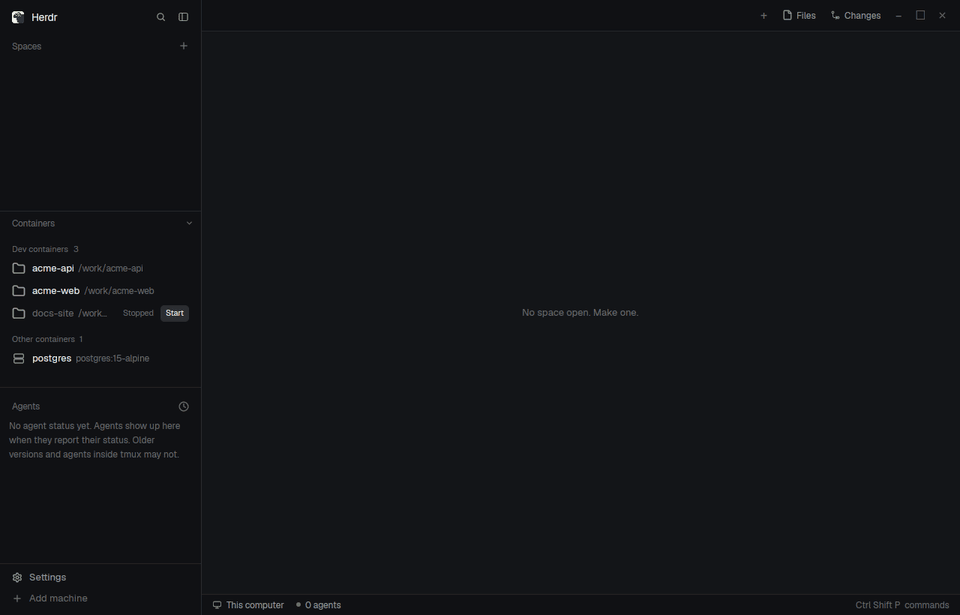

# Herdr Containers

A Herdr mod that puts your Docker dev containers in the sidebar: click one and Herdr opens a space inside it, so your terminals and agents run in the container with its own shell and tools. It adds a Containers panel to the layout you already use, with Start, Repair, Disconnect and Forget, and keeps saved connections visible while Docker is down.



The demo plays at 2x speed ([MP4](herdr-containers/demo.mp4)). The still is [preview.png](herdr-containers/preview.png).

## What it does

- Adds **Dev containers**, **Other containers**, and **Gone** groups between Spaces and Agents, with counts on the group headers.
- Opens running dev containers as spaces; offers Start for stopped ones and inline confirmation before connecting a plain container.
- Keeps saved machines visible through Docker outages, and offers Repair, Disconnect, and Forget where appropriate.
- With optional swaps, adds **Settings → Containers** visibility switches in the sidebar footer.

## Requirements

- Herdr app 0.1.10 and its core (`hc`). The four cloned mods track this version.
- `requirements/hc-devcontainer` on the PATH seen by both app and core.
- Docker, or a Docker-compatible `podman` command on that host (`HC_DEVCONTAINER_DOCKER=podman`). A plain container needs `sh` to connect.
- On Windows: Python 3 (the `py` launcher, or `python` on PATH) and `requirements/hc-devcontainer.cmd` beside the helper. See [Windows](#windows).
- Optional: the [Herdr Core Feature](requirements/feature/herdr-core/README.md) to preserve core state across dev container rebuilds.

## Install

### A. Ask an agent

Give the agent this exact line:

> Read ~/.config/herdr-app/AGENTS.md, then add this mod: herdr.dev/mods/aviv-baruch/herdr-containers

The agent should read the [recipe](herdr-containers/RECIPE.md) and package files, disclose external access, resolve name and key clashes, add the block to your current layout, and check each installed mod. Until the mod appears on herdr.dev, point it at this repo's `herdr-containers/` folder.

### B. Manual

Read the [recipe](herdr-containers/RECIPE.md) and inspect the five mods first. They run `hc`, `hc-devcontainer`, and `git`, inspect Docker containers and workspace files, and cloned Settings reads and writes the app home's `settings.json`. Connection or repair may install Herdr Core in the container or download a matching build from `releases.herdr.dev`. The recipe lists all external access.

Install the helper from this repository on a PATH seen by both the app and core. Restart core if its PATH changed.

```sh
mkdir -p "$HOME/.local/bin"
install -m 755 requirements/hc-devcontainer "$HOME/.local/bin/hc-devcontainer"
hc-devcontainer ls --all --json
```

On Windows, see [Windows](#windows) for the helper instead.

Herdr's app home is `$HERDR_APP_HOME`, else `$XDG_CONFIG_HOME/herdr-app`, else `~/.config/herdr-app`. Check for name clashes before copying. Rename a new mod and all its references if a name is taken; never overwrite an existing mod. The recipe's Watch out lists references inside code. From the repo root:

```sh
app_home=${HERDR_APP_HOME:-"${XDG_CONFIG_HOME:-$HOME/.config}/herdr-app"}
(
  for mod in herdr-containers/mods/*; do
    target="$app_home/mods/${mod##*/}"
    if [ -e "$target" ] || [ -L "$target" ]; then
      printf 'Name clash: %s; nothing copied\n' "$target" >&2
      exit 1
    fi
  done
  mkdir -p "$app_home/mods"
  for mod in herdr-containers/mods/*; do cp -R "$mod" "$app_home/mods/"; done
)
```

Herdr replaces its shipped layouts (`main`, `terminals`, `win98`) on every start, so edit a layout of your own. If you use a shipped one, clone it first; this switches to the clone:

```sh
herdr-app do layout.clone '{"name":"main","as":"my-layout"}'
```

Add this block after Spaces in the `sidebar-lists` column of `$app_home/layouts/<your-layout>.json` (or another suitable column). Keep id `containers` even if you rename the mod: folding resizes that id. Use the renamed mod name in `content.mod` if needed.

```json
{ "id": "containers", "type": "block", "size": { "weight": 1 }, "min": 35, "content": { "mod": "containers" } }
```

Merge [keys.json](herdr-containers/keys.json) into the app home's `keys.json`: add `"ctrl-shift-y": "containers.toggle"` under `"global"`. Ask before replacing a key already in use. If you renamed `containers`, use `<mod>.toggle`. The block also folds by clicking its header.

For full behavior, make these three edits to blocks in the same layout. The four clones are recommended; the `containers` mod works alone.

| Block id | Change its `content.mod` from | To |
| --- | --- | --- |
| `spaces` | `spaces` | `spaces-containers` |
| `agents` | `agents` | `agents-containers` |
| `sidebar-footer` | `workspace-chrome` | `workspace-chrome-containers` |

In shipped `main`, those three blocks become:

```json
[
  { "id": "spaces", "type": "block", "size": { "weight": 1 }, "min": 90,
    "content": { "mod": "spaces-containers" } },
  { "id": "agents", "type": "block", "size": { "weight": 1 }, "min": 90,
    "content": { "mod": "agents-containers" } },
  { "id": "sidebar-footer", "type": "block", "size": { "px": 69 },
    "content": { "mod": "workspace-chrome-containers", "props": { "footer": true } } }
]
```

Edit the existing blocks in place; their positions do not change. The footer opens the installed `settings-containers` mod. Keep its `"props": { "footer": true }`. Without the swaps, the shipped Spaces group can linger for 15 s after disconnect, unreachable spaces do not dim, Agents has no Disconnected group, and footer Settings has no Containers switches; both visibility options stay on. The swaps are copies of Herdr app 0.1.10's shipped mods, so compare before replacing an older or customized version. They need rebuilding and reinstalling to receive fixes from later Herdr releases.

Check each installed mod and the app status. Herdr reloads layout edits live; no layout switch is needed. `herdr-app check` needs a display.

```sh
for name in containers spaces-containers agents-containers settings-containers workspace-chrome-containers; do
  herdr-app check "$app_home/mods/$name"
done
herdr-app status
```

Use adjusted names if you renamed a mod. Leave `RECIPE.md`, `preview.png`, and `demo.*` out of the app home.

### Optional: the Herdr Core Feature

For the optional Feature, from this repo root:

```sh
project=/path/to/project
mkdir -p "$project/.devcontainer"
test ! -e "$project/.devcontainer/herdr-core" && test ! -L "$project/.devcontainer/herdr-core"
cp -R requirements/feature/herdr-core "$project/.devcontainer/herdr-core"
```

Add `"features": { "./herdr-core": { "version": "latest" } }` to that project's `devcontainer.json`, then rebuild. Its [README](requirements/feature/herdr-core/README.md) explains state and version handling. The Feature installs `curl` and `tar` with apt or apk if needed.

### Windows

Windows starts neither shebang scripts nor files without an extension, so the app runs the helper as `cmd /d /c hc-devcontainer …`, and `hc-devcontainer.cmd` starts the Python script beside it. Install both into one folder on the app's PATH, for example the folder that holds `hc`. In PowerShell, from the repo root:

```powershell
$bin = "$env:LOCALAPPDATA\Programs\herdr-core"
Copy-Item requirements\hc-devcontainer, requirements\hc-devcontainer.cmd $bin
hc-devcontainer ls --all --json
```

The panel then lists, starts and checks your containers. Docker Desktop labels dev containers with Windows folders (`c:\Users\…`) and reports their mounts as `/run/desktop/mnt/host/c/…`, `/host_mnt/c/…` or `/mnt/c/…`; the helper treats these as the same folder, ignoring case, wherever it runs.

Connecting needs core to run the helper as a `--via` machine, and Herdr Core on Windows refuses every `--via` command, so **Connect** and **Repair** say so instead. To connect, run Herdr (app and core) inside WSL, or on Linux or macOS, with the helper installed there as above; Docker Desktop's WSL integration gives WSL the same containers.

## Using it

Click a running dev container to connect and open its workspace. A stopped dev container offers **Start**; a plain container asks for **Connect** inline. **Repair** reconnects a rebuilt unreachable machine. **Gone → Forget** removes a saved machine whose container has disappeared. **× → Disconnect** closes its spaces and removes the machine while the container keeps running.

Click a group header to collapse its rows while retaining the count. Click the Containers header, or press **Ctrl+Shift+Y**, to fold the whole block. The sidebar footer's **Settings → Containers** controls visibility; palette and keyboard Settings open Herdr's original settings screen. The list refreshes every 5 seconds while open and active.

## Behavior and resilience

| Case | Behavior |
| --- | --- |
| Stop/start | Stopped dev containers stay listed; **Start** runs `docker start`. A stopped plain container with a machine stays listed too. The machine reconnects in about 2–4 s with the same core id. Agents running in the container die when it stops. |
| Docker daemon restart | Dev containers stay stopped without a restart policy; use **Start**. The machine reconnects in about 2–4 s with the same id. |
| Rebuild with Feature | The preserved state volume keeps the same core id; Herdr reconnects automatically. |
| Rebuild without Feature | Use **Repair** on the unreachable machine row. It adds the container under a spare name first, then removes the old machine and renames the new one, so a failed add leaves the old machine untouched. It opens a new space if needed. |
| Pause | **Paused** replaces the connected dot; unpause the container before opening it. |
| Deleted container | Once Docker reports the container gone, its saved machine appears under **Gone**; a connected machine never does. **Forget** immediately hides its Spaces group, closes its spaces, and removes the machine. |
| Disconnect | Click the **×** on an added container row, then confirm **Disconnect**. The row shows **Disconnecting…** and the Spaces group disappears immediately. Herdr closes its spaces first; the machine connection is removed in the background once they are gone (at most 5 s later). The container keeps running. A removal error restores the row and shows the error. |
| Docker down | Herdr marks the machine unreachable within about 2 s. Containers shows one “Docker isn't running” line and saved container machines as **Disconnected**. Spaces dims their rows and marks their machine groups disconnected; Agents puts their agents in a **Disconnected** group. After a daemon restart, use **Start** for stopped dev containers. |
| Host core restart | Machines reconnect. |
| Duplicate folder | The newest running container wins; the connector warns on stderr. |

The workspace follows the closest bind mount containing the local folder. Otherwise it uses the container's `WorkingDir`; `/` or an empty value leaves the space folder unset. Remote terminals use that user's `HOME` if available, or the core's current directory. Like VS Code's terminal, it starts the user's passwd shell (interactive, not a `-l` login shell) and applies `remoteEnv` from `devcontainer.json` (values pass through the environment, never the command line). `userEnvProbe` does not apply.

## For agents

Read [AGENTS.md](AGENTS.md). Task skills are in [`.agents/skills`](.agents/skills); `.claude/skills` points there.
