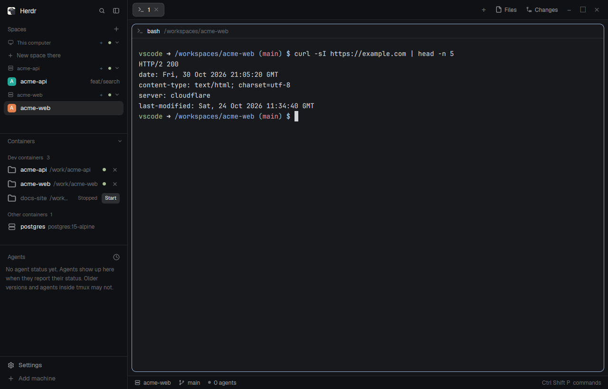

# Herdr Containers

A Containers panel for the sidebar of the layout you already use. It lists the Docker containers on this machine, with dev containers (made by the Dev Containers CLI or VS Code) apart from the rest. Click a running dev container and Herdr connects to it and opens a space in its workspace folder, so your terminals and agents run inside the container with its own shell and tools. Stopped containers offer Start, broken connections offer Repair, and saved connections stay listed while Docker is down. Four optional swaps of Herdr's Spaces, Agents, Settings and footer add instant disconnect, a Disconnected group for agents, and switches for what the panel shows. This is a piece you add to your current layout, not a whole window.



This recipe is the brief for the mod. The files here are one build of it.

## What you see

In Herdr's shipped main layout, put Containers between Spaces and Agents in the 268 px chrome sidebar. The brand above is 46 px, the footer below is 69 px, and the three lists share the remaining height. Spaces and Agents have 90 px minimums; Containers has a 35 px minimum. The canvas, tabs, panes, and status bar stay as they are. Below 160 px sidebar width, the lists become an icon rail.

Containers has a 31 px heading with 11.5 px type and a chevron. Its scrollable list uses the chrome surface and theme border. **Dev containers**, **Other containers**, and **Gone** appear only when they have rows. Their 30 px headers show 11 px dim text and counts. Rows are 30 px high, with 13 px names, 11.5 px dim details, and theme colored status dots. Dev rows show a folder icon, name, local folder, and connection or state; other rows show a server icon, name, image, and state. Saved machines whose containers disappeared appear under Gone with **Forget**. While Docker is unavailable, that group says **Saved machines** and its rows say **Disconnected**.

With the recommended swaps, Agents adds **Disconnected** after its usual groups, and footer **Settings** opens a screen with **Containers → Show other containers** and **Show stopped dev containers** switches.

## How it behaves

Click a running dev container to connect and open or select its workspace space. A plain container asks for **Connect** or **Cancel** inline and explains that connecting copies Herdr Core into it. A paused row asks you to unpause it; a stopped dev container offers **Start**. An unreachable saved connection can offer **Repair**, which creates a spare connection before replacing the old one. Connection, start, repair, disconnect, and forget show progress or an error.

Click a saved row's **×**, then **Disconnect** to close its spaces and remove its machine connection while leaving the container running. The Spaces machine group disappears immediately with the Spaces swap; a removal error restores the row. **Forget** closes spaces and removes a saved machine whose container is gone. When Docker is down, Containers says “Docker isn't running” and saved machines say **Disconnected**. The swaps dim disconnected Spaces rows and machine groups and move their agents to Disconnected.

Agents otherwise keep their shipped status look: working spins in the `working` color; blocked shows a `blocked` **Needs you** pill (a **!** under that heading); done has a filled 7 px `done` dot; idle has a 7 px `idle` ring. A disconnected agent loses that status, moves to Disconnected, dims its name, icon, and subagents, and says **disconnected**.

Click the Containers heading or press **Ctrl+Shift+Y** to fold the block to its 35 px heading; click again to expand. Group headings fold rows but retain counts. Rows and their **×** hover like Spaces rows; section and group headings have no hover background. The list refreshes every 5 seconds while open and the window is active. The footer switches persist across restarts. Palette and keyboard Settings still open Herdr's shipped settings screen.

Terminals start the container user's passwd shell interactively, without `-l`, when the connection has no `SHELL`; they use `/bin/sh` if lookup finds none. With a Dev Containers CLI engine (`HC_DEVCONTAINER_CLI`; else VS Code's bundled `devContainersSpecCLI.js` run by VS Code's Electron, found through the extension's `globalStorage/ms-vscode-remote.remote-containers/cli-bin` record; else `@devcontainers/cli` on PATH), each connection runs VS Code's open sequence: `up --expect-existing-container --skip-post-create` (`initializeCommand`, start), copy `~/.ssh/known_hosts` if absent, lifecycle commands through `waitFor` before connecting and the rest in the background with `REMOTE_CONTAINERS=true`, personalization after `postCreateCommand` (dotfiles from VS Code's settings; the host Git config copied where absent, cleaned up as VS Code does), `gh` logged in with the host token where logged out, then `devcontainer exec`, which applies `remoteUser`, `userEnvProbe`, `remoteEnv` and the workspace folder. VS Code's user `settings.json` switches these as it does in VS Code. Links, listening ports and git credentials are served as described below; SSH and GPG agent forwarding, which VS Code serves from its own server, is not done. Without the CLI it falls back to `docker exec` with `remoteEnv` only, later metadata entries overriding earlier ones.

As in VS Code, a connected container's links open on the host: `BROWSER` hands http(s) URLs to the host's browser (`wslview` or `explorer.exe` on WSL), and ports listening on the container's localhost are forwarded to the same `127.0.0.1` port on the host, so clicked `localhost` links and login callbacks work. Git in the container gets the host's credentials the same way: a `credential.helper` in the container's git config hands each request to the host's `git credential`; it answers nothing without a connection, and prints the host's reason when the host can't answer. Because core may run outside the desktop session, the helper records the session's display, bus and WSL variables when the app runs it and gives them to the host's `git credential` and link opener.

## Built from

One folder, `herdr-containers/`, contains five `mods/<name>/` folders and `keys.json`. It has no `layouts/` folder. The four `*-containers` mods are patched copies of Herdr app 0.1.10's shipped mods, built by `tools/patch-mods.py` and `tools/build-package.py`.

| Mod | Role |
| --- | --- |
| `mods/containers` | Always installed. Draws the list; uses Herdr `exec`, `hc`, `machines`, `spaces`, `run`, `theme`, `layout`, `shared`, `setShared`, `nextCommand`, and `window`. It calls `hc-devcontainer ls --all --json`, `exists VIA`, and `start ID`; `hc machine ls --json`, `add --name NAME --via VIA --install --json`, `rm NAME`, and `rename OLD NEW`; and `space.new`, `space.select`, `space.close`, and `layout.resize`. Shared keys hold visibility, folded groups, removing names, and disconnected machines. |
| `mods/spaces-containers` | Copy of shipped Spaces. Hides groups being removed using `shared("containers.removing")`; dims disconnected groups using `shared("containers.down")`. It refreshes machines through `hc`, runs `git` in space folders, watches repository folders with `watchFolder`, and keeps shipped space actions and menu. |
| `mods/agents-containers` | Copy of shipped Agents. Maps agents' spaces to machines, moves disconnected agents to their own group, dims them, and opens its own sorting popup with `openOverlay`. Keeps shipped `agents`, `spaces`, `terminals`, `panes`, `run`, `shared`, and `setShared` controls. |
| `mods/settings-containers` | Copy of shipped frame Settings. Adds Containers switches using `shared` / `setShared`; keeps shipped `hc`, `run`, `readTextFile`, `writeTextFile`, and `appHome` settings and machine controls. |
| `mods/workspace-chrome-containers` | Copy of shipped chrome. `props().footer` selects footer or brand rendering. Footer Settings opens `settings-containers` with `openOverlay`; other actions keep shipped `run` and `layout.resize`. |

Add this block to the current layout's sidebar column `sidebar-lists`, after Spaces in shipped `main`. Shipped layouts are replaced on every start (an edited one moves to `<name>-edited`), so if the current layout is shipped, clone it first: `herdr-app do layout.clone '{"name":"main","as":"my-layout"}'`, then edit `layouts/my-layout.json`. Keep its id `containers`: folding calls `layout.resize` on that id and treats 35 px or less as folded.

```json
{ "id": "containers", "type": "block", "size": { "weight": 1 }, "min": 35, "content": { "mod": "containers" } }
```

Merge `keys.json` into the app home's keys file: `{ "global": { "ctrl-shift-y": "containers.toggle" } }`. The key is unbound in Herdr's defaults; ask before replacing an existing binding.

For the full behavior, change these `content.mod` values in the current layout after copying the clones. Keep the footer's `"props": { "footer": true }`.

| Block | Shipped `mod` | Replacement `mod` |
| --- | --- | --- |
| `spaces` | `spaces` | `spaces-containers` |
| `agents` | `agents` | `agents-containers` |
| `sidebar-footer` | `workspace-chrome` | `workspace-chrome-containers` (also install `settings-containers`) |

The mods use their own SVGs and shipped icons in `mods/workspace-chrome/`; chrome also uses `frame/welcome/herdr.png`. Shipped `menu`, `picker`, and `machine-add` mods and the installed program icon table remain dependencies. Space avatar colors are `#22a99a`, `#e3814f`, `#5b8def`, `#8b7cf6`, `#3fae6a`, and `#d9649a`.

## Watch out

The requirements live in the same repository, outside this folder: https://github.com/aviv-baruch/herdr-containers/tree/main/requirements. Install [`hc-devcontainer`](https://github.com/aviv-baruch/herdr-containers/blob/main/requirements/hc-devcontainer) (a stdlib Python script; read it first) on the PATH seen by both Herdr app and core, for example `install -m 755 hc-devcontainer ~/.local/bin/`. The host needs Docker or a Docker compatible Podman command; `HC_DEVCONTAINER_DOCKER=podman` selects Podman. Recommended: VS Code with Dev Containers on the host (its engine is used directly), or `npm install -g @devcontainers/cli` with Node.js on the same PATH; `HC_DEVCONTAINER_CLI` overrides the command, an empty value keeps `docker exec`, and `HC_DEVCONTAINER_VSCODE_USER` names another VS Code User folder. Windows always uses `docker exec`. Restart core after changing its PATH. On Windows the app cannot start an extensionless script, so `containers` runs `cmd /d /c hc-devcontainer …` there (`window().platform === "windows"`). Install the helper as `hc-devcontainer.py` beside the two launchers in [`requirements/windows`](https://github.com/aviv-baruch/herdr-containers/tree/main/requirements/windows): `hc-devcontainer.cmd` for the app, and an `hc-devcontainer` sh script for core, which runs a via with Git for Windows' `sh`. Both start Python 3. Connecting on Windows also needs a Herdr Core that accepts `--via` there; released core refuses it, so Connect and Repair say so. The helper matches Docker Desktop's Windows folder labels to their `/run/desktop/mnt/host/c/…`, `/host_mnt/c/…` or `/mnt/c/…` mounts, ignoring case. Without the helper on core's PATH, its shell exits 127 and `hc machine add` can report “hc is not installed.” A plain container needs `sh` to connect.

The optional [`requirements/feature/herdr-core`](https://github.com/aviv-baruch/herdr-containers/tree/main/requirements/feature/herdr-core) dev container Feature downloads Herdr Core from `releases.herdr.dev` into the image when it builds, installing `curl` and `tar` with apt or apk if missing. It preserves core state in a volume across rebuilds. Connecting or repairing runs `hc machine add … --install`: if the container lacks a compatible core, this puts one at the connected user's `~/.local/bin/herdr-core`, adds an `hc` link if absent, and restarts that core. `hc` copies its binary when host and container OS and CPU match; otherwise, including on macOS hosts, it downloads the matching build from `releases.herdr.dev`.

These mods **run programs and read files outside their own folders**. `containers` runs `hc-devcontainer` and `hc`; the helper runs `docker` or `podman`, or the `devcontainer` CLI, which reads the project's `devcontainer.json`, runs `initializeCommand` on the host and lifecycle commands and dotfiles in the container; the helper reads VS Code's user `settings.json`, copies the host's `~/.ssh/known_hosts`, Git config and allowed signers file into the container where absent, and passes the host's `gh auth token` to a logged-out `gh` there, and inspects host containers, labels, mounts, and workspaces. While connected it opens the container's http(s) links with the host's opener, listens on host `127.0.0.1` ports to forward the container's listening ports over `docker exec`, and answers the container's git credential requests with the host's `git credential fill`/`approve`/`reject`, after adding its helper to the container's git config (`dev.containers.gitCredentialHelperConfigLocation` in VS Code's settings: `global`, `system`, or `none`). It writes the app's desktop session variables (display, session bus, WSL interop) to `~/.local/state/hc-devcontainer/desktop.json` for those host programs. `spaces-containers` runs `git` in space folders, watches repository folders, and calls `hc`. `settings-containers` reads layout JSON files and reads and writes the app home's `settings.json`; it also calls `hc`. The other clones call Herdr commands and use shared state. No package mod makes its own network request. The network use is the `hc` and Feature downloads above; app and core update controls inherited by cloned Settings retain their shipped behavior.

Never overwrite a mod name. On a clash, rename the new folder and all references to that mod, including `mods/<name>/` asset paths, the block's `content.mod`, the key action `containers.toggle` (`<mod>.toggle`), `openOverlay({ mod: "settings-containers" ... })` in `workspace-chrome-containers`, and `openOverlay({ mod: "agents-containers" ... })` in `agents-containers`. Keep block id `containers` and shared keys `containers.*`; they are not mod names.

The swapped clones are frozen copies: they do not receive fixes to Herdr's shipped Spaces, Agents, Settings, or chrome until rebuilt and reinstalled. On a newer Herdr, rebuild from this recipe or run `tools/build-package.py` against that version's defaults and check each clone. If only `containers` is installed, the shipped Spaces group can linger for its 15 s machine cache, unreachable spaces do not dim, Agents has no Disconnected group, and footer Settings has no Containers switches. Both visibility options stay on.

The connector picks the closest matching bind mount for a dev container's workspace, then its working directory; an empty directory or `/` leaves the space folder unset. Remote terminals use that user's `HOME` if available, or the core's current directory. A container's `userEnvProbe`, lifecycle commands and personalization apply only through the Dev Containers CLI, not the `docker exec` fallback; their output goes to `${XDG_STATE_HOME:-~/.local/state}/hc-devcontainer/<container>.log`, rewritten per connection. If several running dev containers share a folder, the newest wins and the helper warns on stderr.

## Done when

- Panel only: `herdr-app check` passes for `containers`; the current layout shows Dev and Other groups; a running dev container opens a space; a plain container asks for Connect; `containers.toggle` folds the block to 35 px and back; `herdr-app status` has no errors.
- With swaps: `herdr-app check` passes for all five mods; Disconnect removes the Spaces group immediately; Docker down shows saved machines as Disconnected and dims Spaces and Agents; footer **Settings → Containers** changes visibility; the global **Ctrl+Shift+Y** key folds the block.
